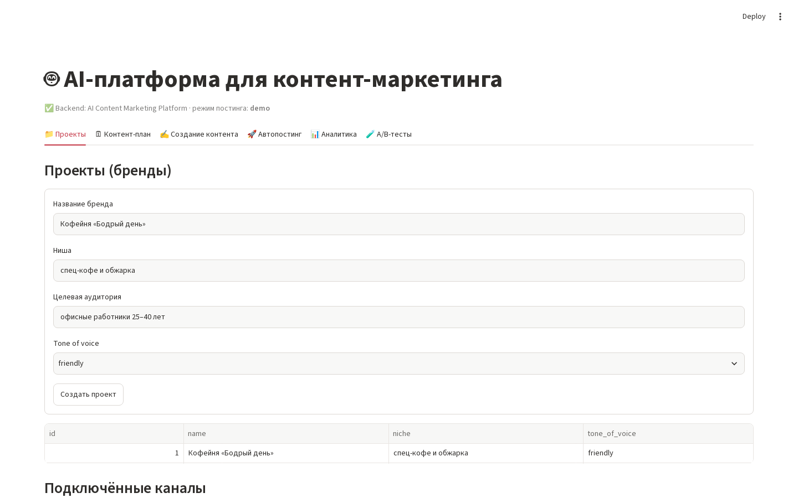

<div align="center">

# ContentPilot AI

**Планирование контента и публикаций с помощью ИИ для маркетинга в разных каналах**


[Возможности](#возможности) · [Быстрый старт](#быстрый-старт) · [Архитектура](#архитектура) · [Текущее состояние](#текущее-состояние) · [Участие в разработке](#участие-в-разработке)

</div>

---

ContentPilot AI — платформа для контент-маркетинга: она помогает вести проекты брендов, планировать кампании, создавать тексты для разных каналов и управлять публикациями. В проекте используются FastAPI, интерфейс на Streamlit и слой данных SQLAlchemy с поддержкой SQLite и PostgreSQL.

Платформа объединяет весь цикл работы с контентом:

**Бриф бренда → контент-план → создание текстов с помощью ИИ → проверка → публикация → анализ результатов**



## Возможности

| Раздел | Возможности |
|---|---|
| Рабочие пространства брендов | Организация проектов по нише, аудитории, сайту и тону коммуникации. |
| Планирование контента | Создание идей на месяц с датами, каналами, типами публикаций и сезонным контекстом. |
| Создание текстов с помощью ИИ | Генерация по контент-плану или краткому брифу через OpenAI, если он настроен; предусмотрен локальный резервный режим. |
| Варианты для A/B-тестов | Создание и сравнение двух вариантов текста для одного пункта контент-плана. |
| Процесс публикации | Согласование контента, запуск публикации и просмотр её статуса в журнале. |
| Аналитика результатов | Сводные показатели по каналам и оценка результатов контента. |
| REST API | API для проектов, аккаунтов, планов, контента, публикаций, аналитики и тестов. |

### Интеграции

В проекте есть адаптеры для Telegram, VK, Instagram, WordPress и Mailchimp. Перед использованием в production необходимо проверить каждый адаптер с учётом актуального API провайдера, разрешений и настроек аккаунта. Прежде чем включать реальные публикации, ознакомьтесь с разделом [«Текущее состояние»](#текущее-состояние).

Требования к учётным данным, аккаунтам и ограничения прототипа описаны в документе [«Настройка каналов и проверка реальных интеграций»](docs/INTEGRATIONS.md). Оставшиеся этапы подготовки перечислены в документе [«Готовность к сдаче»](docs/SUBMISSION_READINESS.md). Пример настроек находится в `.env.example`; реальные секреты храните только в локальном `.env` и никогда не добавляйте его в коммиты.

## Быстрый старт

### Требования

- Python 3.10 или новее
- PostgreSQL для общего развёртывания; по умолчанию локально используется SQLite
- Ключ API OpenAI — только если для генерации контента нужен OpenAI

### Установка в Windows

Выполните эти команды в PowerShell из корневой папки репозитория:

```powershell
python -m venv .venv
.\.venv\Scripts\python.exe -m pip install --upgrade pip
.\.venv\Scripts\python.exe -m pip install -r requirements.txt
```

### Запуск приложения

В первом окне терминала запустите API:

```powershell
.\.venv\Scripts\python.exe -m uvicorn app.main:app --reload --port 8000
```

Во втором окне терминала запустите веб-интерфейс:

```powershell
.\.venv\Scripts\python.exe -m streamlit run frontend/streamlit_app.py
```

| Сервис | Адрес |
|---|---|
| Рабочее пространство контента | <http://localhost:8501> |
| Документация API | <http://localhost:8000/docs> |
| Проверка состояния сервиса | <http://localhost:8000/health> |

### Необязательно: загрузить демонстрационные данные

```powershell
.\.venv\Scripts\python.exe scripts/seed_demo.py
```

При каждом запуске скрипт создаёт новый демонстрационный проект. Чтобы начать с чистого рабочего пространства, используйте отдельную базу данных.

## Настройка

Настройки считываются из переменных окружения или локального файла `.env`. Не допускайте попадания учётных данных в Git и журналы.

| Переменная | Значение по умолчанию | Назначение |
|---|---|---|
| `DATABASE_URL` | `sqlite:///./data/content_platform.db` | URL базы данных SQLAlchemy. Для PostgreSQL используется `postgresql+psycopg://...`. |
| `POSTING_MODE` | `demo` | Выбор демонстрационного режима без отправки или настроенных адаптеров каналов. |
| `OPENAI_API_KEY` | не задан | Включает генерацию планов и текстов через OpenAI. |
| `OPENAI_MODEL` | `gpt-4o-mini` | Название модели OpenAI. |
| `AI_FALLBACK_LOCAL` | `true` | Разрешает локальную генерацию, если запрос к OpenAI завершился ошибкой. |
| `API_BASE` | `http://localhost:8000` | Адрес FastAPI, используемый интерфейсом Streamlit. |
| `TELEGRAM_BOT_TOKEN` | не задан | Учётные данные бота Telegram. |
| `VK_ACCESS_TOKEN` | не задан | Учётные данные API VK. |
| `IG_ACCESS_TOKEN` | не задан | Учётные данные Instagram Graph API. |
| `WP_URL`, `WP_USER`, `WP_APP_PASSWORD` | не заданы | Сайт WordPress и учётные данные приложения. |
| `MAILCHIMP_API_KEY`, `MAILCHIMP_SERVER`, `MAILCHIMP_AUDIENCE_ID`, `MAILCHIMP_REPLY_TO` | не заданы | Ключ API Mailchimp, префикс дата-центра, аудитория и разрешённый адрес для ответов. |

Никогда не добавляйте `.env` и production-учётные данные в коммиты. Перед включением реальных публикаций проверьте разрешения и адресатов на тестовых аккаунтах, которыми владеете вы или владелец которых явно разрешил такое использование.

## Архитектура

```text
Streamlit workspace ── HTTP/JSON ──> FastAPI ──> application services
                                          │             ├── AI content generation
                                          │             ├── channel publishing adapters
                                          │             └── analytics and A/B evaluation
                                          └── SQLAlchemy ──> SQLite / PostgreSQL
```

| Путь | Назначение |
|---|---|
| `app/main.py` | Приложение FastAPI, проверка состояния и планировщик задач. |
| `app/api/routes/endpoints.py` | Маршруты REST API. |
| `app/models/` и `app/schemas/` | Модели SQLAlchemy и схемы API на Pydantic. |
| `app/services/ai/` | Генерация контент-планов и текстов. |
| `app/services/posting/` | Адаптеры каналов и записи о публикациях. |
| `app/services/analytics/` | Сбор метрик и расчёт результатов A/B-тестов. |
| `app/workers/tasks.py` | Задачи Celery для развёртываний с worker-процессом и брокером. |
| `frontend/streamlit_app.py` | Рабочее пространство контента на Streamlit. |
| `tests/` | Тесты API. |

## Обзор API

Интерактивная документация API: <http://localhost:8000/docs>

| Метод | Endpoint | Назначение |
|---|---|---|
| `GET`, `POST` | `/api/projects` | Получить список проектов брендов или создать проект. |
| `GET`, `POST` | `/api/projects/{id}/accounts` | Получить список каналов проекта или подключить канал. |
| `GET`, `POST` | `/api/plans`, `/api/plans/generate` | Получить или сгенерировать контент-планы. |
| `PATCH` | `/api/plans/{id}/approve` | Согласовать пункт контент-плана. |
| `GET`, `POST` | `/api/content`, `/api/content/generate` | Получить контент или сгенерировать варианты по плану. |
| `POST` | `/api/content/brief` | Создать контент по краткому брифу. |
| `POST` | `/api/publish` | Запустить процесс публикации. |
| `POST` | `/api/autopost/run-due` | Обработать наступившие по сроку согласованные публикации. |
| `GET`, `POST` | `/api/analytics/*` | Синхронизировать и получить аналитику. |
| `GET`, `POST` | `/api/ab-tests` | Получить список A/B-тестов или создать тест. |
| `POST` | `/api/ab-tests/{id}/evaluate` | Обновить метрики и оценить результаты A/B-теста. |

## Текущее состояние

Приложение запускается локально. Набор тестов API охватывает создание проектов, генерацию планов и текстов, процесс публикации, аналитику и оценку A/B-тестов. Публикацию и сбор аналитики для конкретных провайдеров ещё необходимо проверить в production.

| Возможность | Текущая реализация |
|---|---|
| Генерация контента | При наличии настроек используется OpenAI, иначе — локальные шаблоны. |
| Публикация | В режиме по умолчанию (`POSTING_MODE=demo`) результат записывается локально, без обращения к каналу. Адаптеры для реальной публикации есть, но их работа с API провайдеров и учётными данными не проверена полностью. См. [настройку каналов и проверку интеграций](docs/INTEGRATIONS.md). |
| Учётные данные каналов | API аккаунтов маскирует переданный токен, но не сохраняет его для последующего использования адаптерами. Сейчас адаптеры получают данные провайдеров из переменных окружения. |
| Аналитика | Метрики формируются локально; сбор данных через API провайдеров не реализован. |
| Оценка A/B-тестов | Сравнивает доступные метрики по простому правилу минимального размера выборки; статистическая значимость не рассчитывается. |
| Аутентификация | Аутентификация конечных пользователей, авторизация и изоляция арендаторов не реализованы. |

Это ограничения текущей реализации, а не заявление о сертификации интеграций провайдерами. Перед использованием сервиса с production-аккаунтами или данными клиентов необходимо завершить интеграционные тесты для конкретных провайдеров, обеспечить безопасное хранение секретов и контроль доступа, а также усилить защиту развёртывания.

## Тесты

Установите зависимости и запустите тесты на временной базе SQLite:

```powershell
$db = Join-Path $env:TEMP ("contentpilot-tests-" + [guid]::NewGuid().ToString("N") + ".db")
$env:DATABASE_URL = "sqlite:///" + $db.Replace("\", "/")
.\.venv\Scripts\python.exe -m pytest -q
$testResult = $LASTEXITCODE
Remove-Item -LiteralPath $db, ($db + "-shm"), ($db + "-wal") -Force -ErrorAction SilentlyContinue
Remove-Item Env:DATABASE_URL
if ($testResult -ne 0) { exit $testResult }
```

## Скриншоты и демонстрация

В [скриншотах](docs/screenshots/01_projects.png) показано основное рабочее пространство. Также доступны [запись полного сценария работы](docs/screencast.webm) и [техническое задание](docs/Technical_Specification.docx).

Чтобы обновить скриншоты и запись, один раз установите браузер для Playwright:

```powershell
.\.venv\Scripts\python.exe -m playwright install chromium
```

Для записи демонстрации используйте отдельную базу SQLite и демонстрационный режим во всех трёх окнах PowerShell. Данные записи не смешаются с рабочими, а реальные запросы к провайдерам выполняться не будут:

```powershell
New-Item -ItemType Directory -Force .capture-temp | Out-Null
$env:DATABASE_URL = "sqlite:///./.capture-temp/capture.db"
$env:POSTING_MODE = "demo"
$env:OPENAI_API_KEY = ""
```

В первом окне запустите API, во втором — Streamlit с теми же переменными окружения, а затем в третьем выполните:

```powershell
.\.venv\Scripts\python.exe scripts/make_screenshots.py
```

Скрипт проверяет, что API запущен в демонстрационном режиме, затем добавляет тестовый проект, план для Instagram, варианты для A/B-теста, демонстрационные публикации и имитацию аналитики и записывает интерфейс. Папка `.capture-temp/` исключена из Git.

## Участие в разработке

Мы рады вкладу в проект. Есть идея или нашли ошибку? [Создайте issue](https://github.com/nifontovoleg/ContentPilot-AI/issues), чтобы обсудить её, или отправьте pull request с конкретным изменением и тестами. Особенно полезны интеграционные тесты провайдеров, безопасная работа с учётными данными, адаптеры сбора реальной аналитики и усиление защиты развёртывания.

Перед отправкой pull request:

1. Создайте отдельную ветку и опишите, как изменение повлияет на пользователей.
2. Запустите `python -m pytest -q`; добавьте или обновите тесты для изменённого поведения.
3. Не добавляйте в коммиты ключи API, токены аккаунтов, персональные данные и файлы `.env`.
4. Документируйте изменения настроек и требования конкретных провайдеров.

В репозитории пока нет файлов `CONTRIBUTING.md` и лицензии. До приёма внешних вкладов или представления проекта как открытого исходного кода необходимо определить условия участия и повторного использования.

Хотите помочь развивать ContentPilot AI? [Создайте issue](https://github.com/nifontovoleg/ContentPilot-AI/issues) или отправьте pull request с конкретным изменением и тестами.
